# Vivarium (W18 realism pass)

An isolated, client-rendered macro habitat. Open `/vivarium`; expand 「飼育びんの設定」
to review the four stages, decoder actions, expressed traits, habitat and quality.
No game account, API, brain service, remote texture service or model download is required.

## W16 integration

Import **only** `Vivarium.tsx` from a client component. It uses `next/dynamic` with
`ssr: false`; importing the entry does not eagerly import Three.js. Give its parent
an explicit height. React 19 refs are supported directly.

```tsx
import { useRef } from "react";
import { Vivarium, type VivariumHandle } from "@/components/vivarium/Vivarium";

function HabitatPreview() {
  const view = useRef<VivariumHandle>(null);
  const placeOdour = () => {
    view.current?.pointOfInterest([0.65, -1.08, -0.2]);
    view.current?.setBehaviour("approach");
  };
  return <div style={{ height: "70dvh" }}>
  <Vivarium
    ref={view}
    stage="adult"
    behaviour="walk"
    sex="f"
    traits={["white", "curly"]}
    seed="individual-id"
    quality="auto"
    environment={{
      humidity: 0.7,
      food: { color: "#bda45c", moisture: 0.7, yeast: 0.4 },
      mould: 0.1,
      grime: 0.2,
      pupaAge: 0.4,
    }}
  />
    <button onClick={placeOdour}>匂いを置く</button>
  </div>;
}
```

- `stage` accepts the API's `egg`, `larva1`, `larva2`, `larva3`, `wandering`, `pupa`,
  `adult`, plus the preview alias `larva`. Instars differ in size.
- Decoder labels are `rest`, `walk`, `turn_left`, `turn_right`, `feed`, `escape`,
  `groom`, `approach`, `avoid`. `fly` and `burrow` are explicit motor previews;
  `stop` and `flee` alias resting/escape behavior. This component does not fabricate
  brain decisions or sample the API's probability map: pass the selected label.
- Use **expressed `phenotypes`**, never hidden carrier alleles or only `strain`.
  `white`, `yellow`, `ebony`, `curly`, `vestigial` combine. The visual-only rule for
  simultaneous yellow/ebony is ebony precedence; simultaneous curly/vestigial keeps
  both shortening and curl. The server still owns inheritance. Vestigial adults
  escape on foot. Male abdomen pigmentation/tip and foreleg sex combs differ.
- Environmental scalars are normalized **0–1**, clamped with finite defaults.
  `pupaAge` darkens the case. Food color is a CSS/Three color; moisture changes its
  sheen, yeast changes surface colonies, mould adds patches, grime increases haze.
- Public coordinates remain the W16 care/decoder units: food `-1.075`, radius
  `1.065`, Y up. `scale.ts` converts these to **millimetres only at the render
  boundary**, and inverts raycast picks before calling consumers. Stored pupation
  sites, wiping UVs and `pointOfInterest` need no migration. Body sizes use separate
  uniform anatomical scales; ground clearance and emergence offsets are physical.
- Props apply when they change. Imperative commands take effect immediately; only
  calls made before mounting are queued, consumed once. Prop changes subsequently
  take precedence. Changing `seed` or `stage` resets motor state.
- `framing="close"` tracks the individual, with optical magnification adjusted for
  eggs/pupae. Drag rotates, pinch/wheel zooms within bounds. `paused` stops motor
  motion and idle drift while still allowing inspection and habitat edits.
- Reduced-motion slows motor timing to 35% and disables idle drift. Hidden documents
  stop the continuous render loop. WebGL absence, context loss and render errors
  show a stage-specific static render; reload to retry a lost context.

## W18 reference study

Inspected these real photographs during the pass; **none of their pixels are shipped**:

- [Masur, laboratory culture vial, MPI-CBG (2011)](https://commons.wikimedia.org/wiki/File:Drosophila_melanogaster_laboratory_culture-vial.jpg):
  a tall narrow vessel, small adults, a deep compressed plug, food confined to the bottom,
  a raised wet edge and restrained glass highlights. Used for relative scale and composition.
- [MIKROMAN6 / Getty Images, Drosophila close-up in Knowable (2018)](https://knowablemagazine.org/content/article/living-world/2018/tricks-and-traits-let-insects-take-flight):
  the image immediately above “Halteres: more than gyroscopes” shows fine eye facets,
  sparse long bristles over dense short setae, slender articulated legs, translucent veins
  and uneven matte cuticle. Used for material and anatomy detail, not as a texture.

The requested 25 mm diameter / 95 mm vessel height and approximately 2.5 mm female body
length are explicit scene targets, not measurements inferred from an uncalibrated photo.

## Rendering and physical scale

- One renderer unit is **1 mm**. The vial has a 0.7 mm wall, a 1.5 mm bottom and a
  rolled rim. The food extends from 1.5 to 21.5 mm, plus a 0.65 mm wall meniscus.
  Egg body is 0.5 mm, mature larva 4 mm, pupa about 3 mm. Instar scaling is retained.
  The adult is deliberately tiny in the wide view; optical framing provides magnification.
- Cornmeal has actual height relief, pits and a recessed wandering tunnel. The side
  follows the meniscus without an open seam. Seeded meal grain, dark damp patches,
  wet clearcoat breakup and instanced yeast/mould respond to the original habitat props.
  Edge sheen is an inexpensive scattering approximation, not volumetric food transport.
- Adults have smaller eyes/head proportions, tapered articulated legs with attached
  setae, abdomen/thorax/head bristles, separate cuticle roughness, and antialiased
  pigmented abdominal bands. Compound-eye facets remain a bump/albedo lattice.
  Resting wings slope along the abdomen; veins follow the same surface. Dielectric
  membrane alpha and thin-film strength increase only at grazing angles. Curly,
  vestigial, white, yellow, ebony and sex differences remain supported.
- The cotton core uses tangled fibre/pore detail plus 800 surface fibres at medium
  (1,700 high; 200 low). Condensation clusters predominantly near the upper wall.
- Medium/high glass uses one 1024² offscreen buffer (one/three samples respectively),
  including translucent organisms and food. Native transmission alone erased eggs,
  pupae and larval skin behind the glass; the buffer preserves the complete subject.
  The outer shell and rolled mouth use thickness-based refraction, IOR 1.48 and faint
  roughness smudges. Low uses a cheap alpha glass approximation; droplets use alpha
  and clearcoat to avoid another full transmission pass. This is not path tracing.
- An original procedurally painted, softly blurred cool window and warm lamp background
  sits behind a real bench plane. The existing original studio HDR supplies reflections.
  Warm key and rim lights have inverse-square falloff in mm; cool fill remains soft.
- The camera stays outside the wall. A 4.8 mm virtual sensor and stage-specific fields
  of view provide macro framing. DOF derives from focal length and focus distance in mm
  (f/5.6, 0.003 mm circle of confusion), bounded to 1.1–24 mm for readable inspection.
  This small-distance approximation is an artistic optical model, not calibrated lens data.
  The default wide composition reserves the top fifth for the title and lower space
  for controls. Medium/high retain DOF; high adds AO. Both use subtle bloom/grain.
- Original pause, visibility, reduced-motion, action controller, context-loss and
  WebGL-unavailable fallbacks remain. Larval organs share one instanced draw and
  paused deformation is skipped. Camera and leg updates reuse scratch vectors. A single
  shadow map update is shared by the refraction and main passes; pose and tracking
  update before the buffer capture so both views use the same frame.

## Before / after

These are actual WebGL renders at 1400×1000, high quality, paused, same seeded subject.
“Before” preserves the checked-in W16 captures; camera framing intentionally changes
with physical scale. No photographic reference is embedded in these comparisons.

| Stage / framing | Before | After |
| --- | --- | --- |
| adult wide |  | 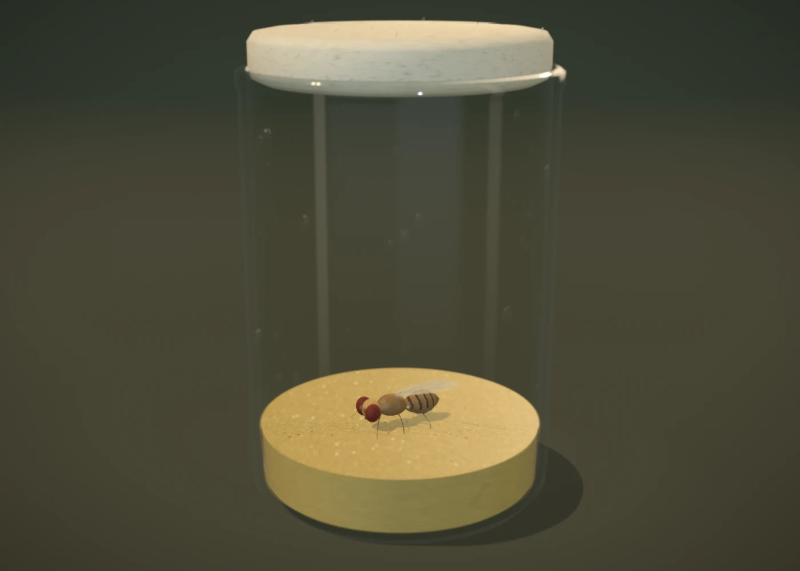 |
| adult close | 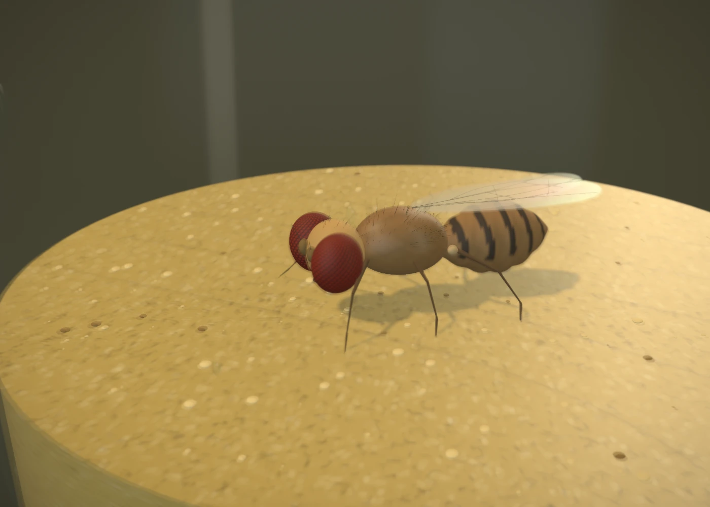 |  |
| egg wide |  |  |
| egg close | 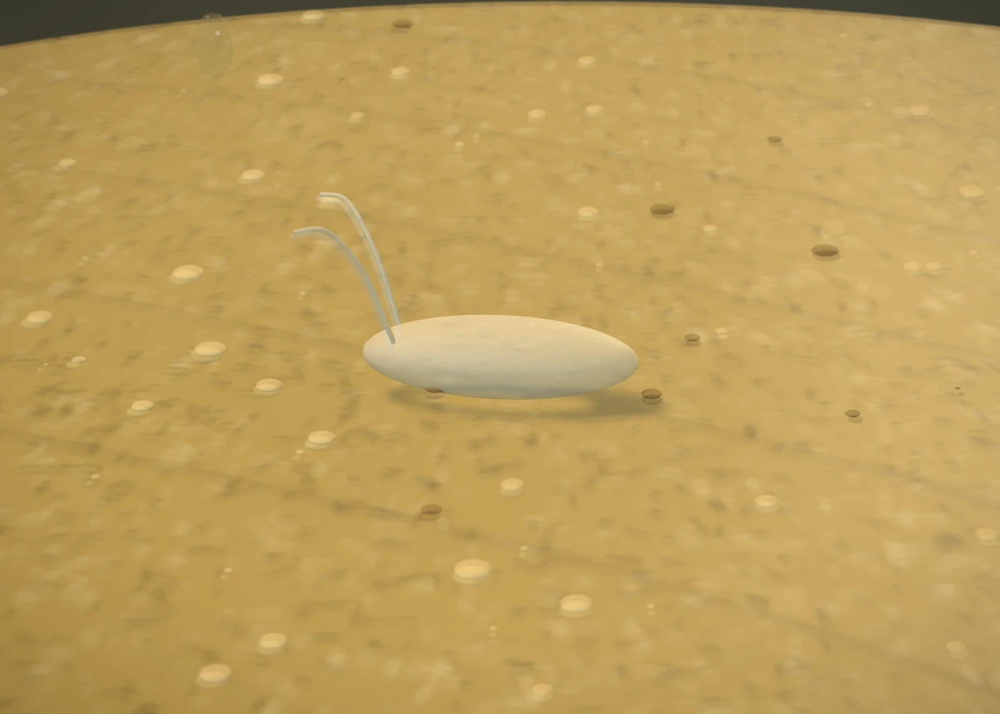 | 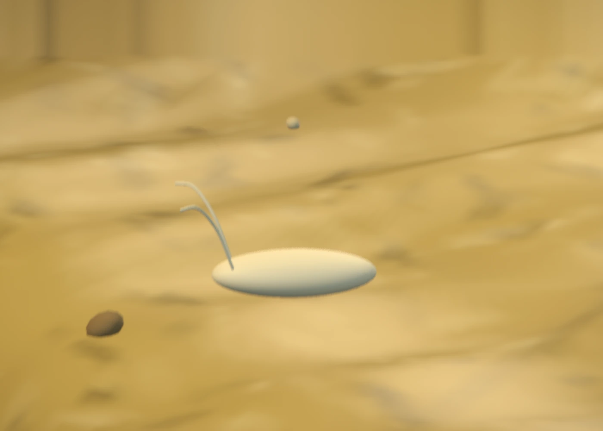 |
| larva wide |  | 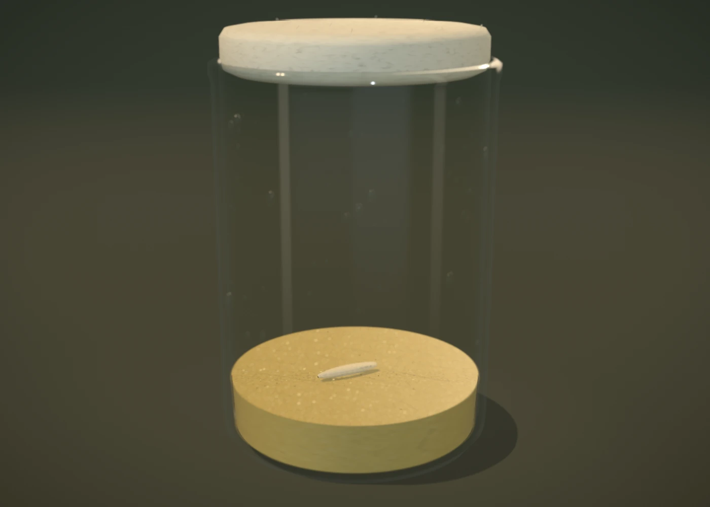 |
| larva close | 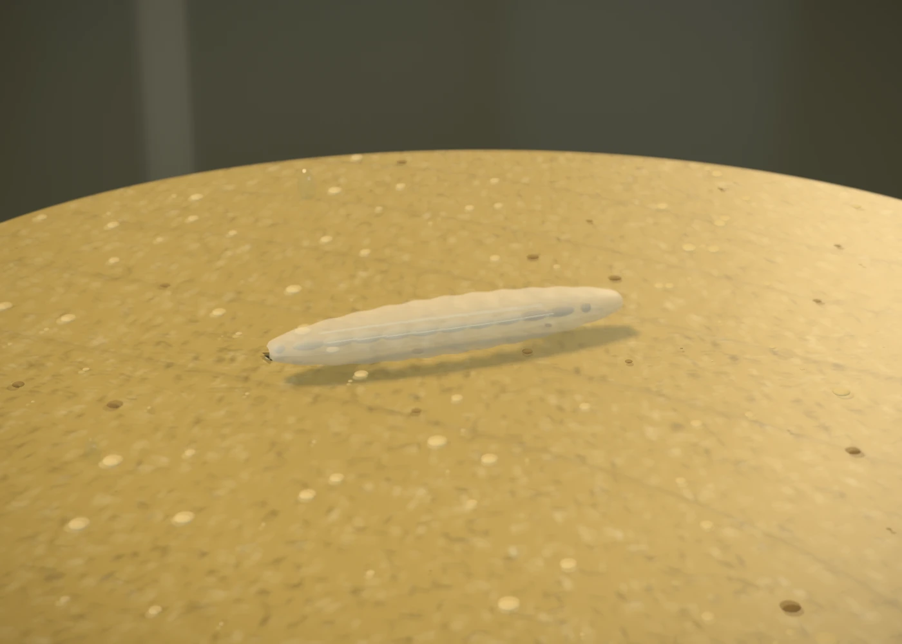 | 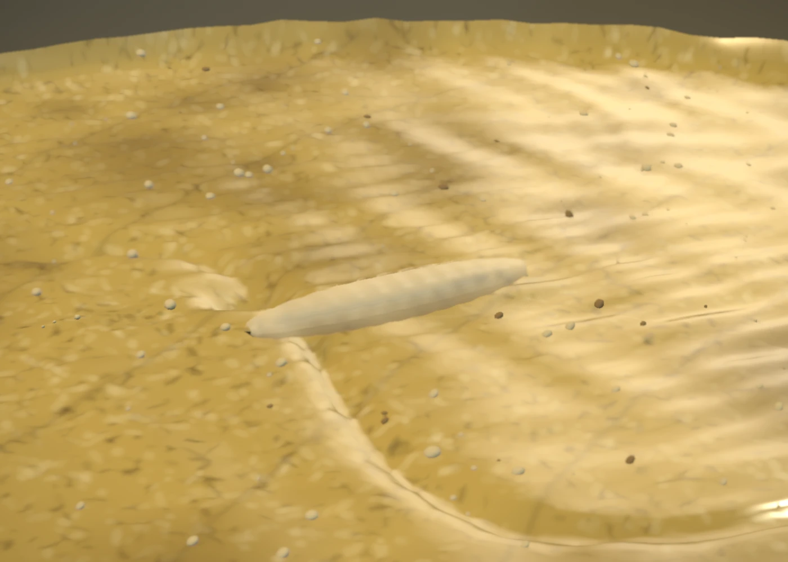 |
| pupa wide |  | 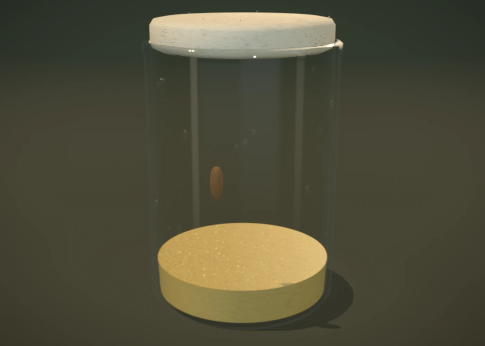 |
| pupa close | 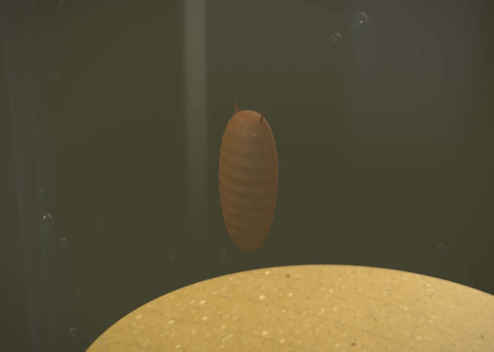 |  |

Phone composition at 390×844, medium, with the real overlay:

| Wide | Close |
| --- | --- |
| 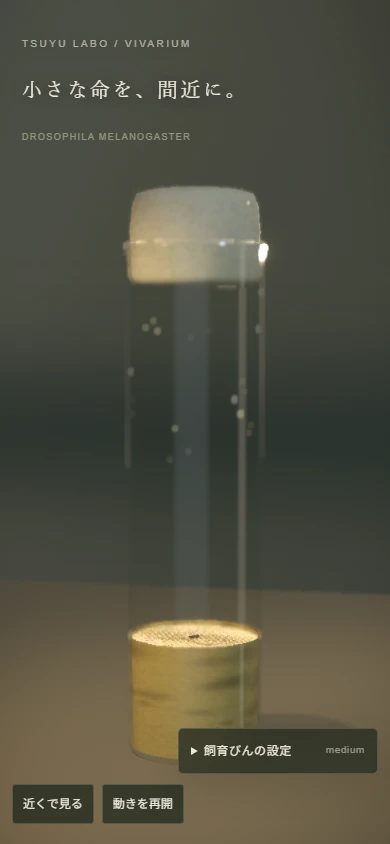 | 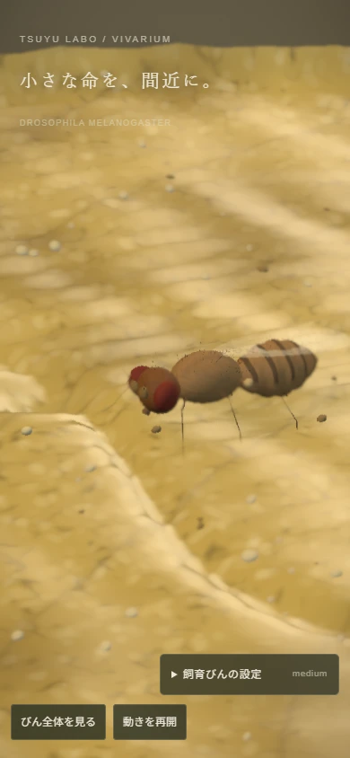 |

## Budgets and measurements

| Tier | Max DPR | Body hairs | Max droplets | Shadow map | Post |
| --- | ---: | ---: | ---: | --- | --- |
| high | 1.75 | 420 | 110 | 2048 | DOF, AO, bloom, grain, vignette |
| medium | 1.25 | 180 | 48 | 1024 | DOF, bloom, grain, vignette |
| low | 1 | 65 | 16 | off | off |

Auto quality still lowers a tier after sustained <48 fps, without oscillation; explicit
quality stays fixed. Hidden documents stop rendering and reduced motion slows the motor.

Production measurement on 2026-10-13: Chromium / Three r184, Windows ANGLE Vulkan
**SwiftShader**, 390×844 CSS pixels, DPR 1, adult walking, explicit quality,
reduced motion disabled. Each result uses 60 RAF intervals after 15 warmup intervals.
Draw/triangle counts are the renderer's complete previous-frame snapshot, including
refraction, shadow and post passes (not unique geometry).

| Tier | Mean fps | p95 frame ms | Draw calls | Submitted triangles |
| --- | ---: | ---: | ---: | ---: |
| low | 6.35 | 300.1 | 54 | 66,094 |
| medium | 2.20 | 1,016.6 | 61 | 107,876 |
| high | 0.97 | 2,000.0 | 61 | 123,216 |

Sharing the shadow update reduced the medium snapshot from 116 calls / 215,372
triangles to 61 / 107,876. This is a pass-count reduction, not a portable speedup
claim; software timing is noisy. Low remains the automatic software-renderer choice.
The current medium result does **not** meet 60 fps in this measured environment.

**60 fps on a physical mid-range phone remains unverified.** A 390×844 desktop browser
viewport and SwiftShader timings cannot establish Android/iOS hardware acceptance.
Owner review of photographic realism also remains necessary: this is procedural anatomy,
not a specimen scan. In particular glass is screen-space refraction, eye facets are mapped
rather than separate lenses, and translucency is an approximation.

## Verification and reproduction

From the repository root (Windows):

```powershell
npm.cmd run lint -w apps/web
npm.cmd run typecheck -w apps/web
npm.cmd run test -w apps/web
npm.cmd run test:e2e:helpers -w apps/web
npm.cmd run build -w apps/web
$env:PLAYWRIGHT_BROWSERS_PATH = "$PWD/.tools/browsers"
npx.cmd playwright install chromium
npm.cmd run start -w apps/web -- --port 3018 --hostname 127.0.0.1
# Another terminal, with the same browser path:
$env:VIVARIUM_URL = "http://127.0.0.1:3018"
node apps/web/src/components/vivarium/capture.mjs
```

The runner saves eight stage images, two phone compositions and four static fallbacks.
It checks theme independence, phone controls, decoder actions, prop/imperative precedence,
pause while editing humidity, paused stage swaps without replacing the canvas, context
loss and WebGL absence. A default-fixture colour
mask in the macro region rejects missing animals, in addition to the blank-image check;
this is a regression guard, not a photographic-realism score. It samples 60 frame
intervals per tier after 15 warmup intervals and writes the renderer name and results
to ignored `.codex-runs/vivarium-report.json`. `VIVARIUM_SKIP_CAPTURES=1` skips image
writes; `VIVARIUM_PERF_TIERS=medium` limits profiling; `VIVARIUM_NATIVE_GPU=1` removes
the software-renderer flags, but still does not make a desktop browser a physical phone.
Do not rebuild while a production server is serving the previous build.

W18 checks: web lint, explicit typecheck and production build passed; **300 unit tests
in 38 files** and **25 E2E-helper tests in 3 files** passed. Production Chromium captures
and the interactions above passed without JavaScript or WebGL shader errors.

Regression coverage includes scale anchors, care-coordinate round trips, foot contact,
physical emergence clearance, upward food normals and recessed surface relief.
No W18 server/gameplay behavior changed; the W16 real-API week run below is historical,
not a claim that the complete server integration suite was rerun during this visual pass.

## W16: the live rearing vial

Home mounts `ColonyVivarium` only after there is an active individual or an owned adult.
It renders one lazy Three scene at a time; the swipe strip changes the selected vial and
unmounts the old canvas. Camera orbit gestures and colony swipe gestures have separate
surfaces. Needs, available care, time of day and pause controls remain in glass panels.
The original cosmetic inventory remains under 「飼育棚の飾り」.

`CareVial` uses the same current-week ID, API stage and persisted `vial` as home. Meal
submissions return their verified medium; `CareConsequence` pours it into the substrate
and drives larval feeding. Accepted care results sit beside the vial rather than covering
it with a modal, so the pour and the learned odour choice remain visible and interactive.
A rejected submission cannot show a saved care consequence.
Temperature uses a glass dial overlay and the existing swinging-needle score;
touch/release or the stop button
freezes it. Humidity is a range dial. Preview pace/condensation change before submission;
the server saves them only on accepted care. Pupation taps select the nearest of the
three public site heights; confirmation still submits the existing option ID.

`GlassCare` raycasts the fixed-camera front half of the cylinder into a canvas texture.
Stamps erase its alpha mask. `wiping.ts` previews the same 18×12 cell coverage as Python;
the API validates the timestamps/coordinates and applies the existing cleaning rewards.
The disclosure 「静止画・キーボードで拭く」 sends the same stamps when WebGL is unavailable.
This keeps a usable fallback without pretending the static image reacts in 3D.

`OdourMoment` uses the existing one-trial odour-choice job on the owned brain snapshot.
Its measured toward/away outcome drives an eight-second approach/avoid moment; a tie
rests. Hidden documents and the home pause control preserve the remaining observation
time. Each new job starts a fresh moment even if the outcome is the same. Training waits
for a queued learning job before enabling observation. No association
value is converted into a made-up decision. Home's baseline is the decoder's finite
maximum; it refreshes every 30 seconds only while visible and unpaused.

Eclosion uses the server's saved vial and adult phenotypes. The case opens, the adult
emerges inward from the chosen site, its wings expand and harden, then evaluation/title appear.
Pause, visibility suspension, reduced motion and skip are supported. Rewards and adult
rolls remain in the existing API transaction. Environmental decay is documented in
`docs/specs/game-rules.md`; these visual scalars do not introduce new growth/reward rules.

Run the updated `week.spec.ts` and `vial-accessibility.spec.ts` against the real API.
The week runner saves actual home, meal, wiping and eclosion renders to
`docs/media/v2/integrate-*.webp`. Set `E2E_MEDIA_DIR` to override the destination and
`E2E_SOFTWARE_WEBGL=1` for reproducible software WebGL. The software renderer is very
slow; it is not physical-phone performance acceptance. Profile Android/iOS on device
before claiming the 60 fps target or absence of device-level frame drops.

### Run W16 on Windows

Use three terminals at the repository root. In the API terminal, warm the real brain
import before announcing server readiness; on a cold Windows host the first lazy import
can exceed the client's 12-second request timeout. This uses the real engine, not a test
adapter. Limit its CPU threads to keep the host cool.

```powershell
New-Item -ItemType Directory -Path .codex-runs -Force | Out-Null
$env:UV_CACHE_DIR = "$PWD/.uv/cache"
$env:DATABASE_URL = "sqlite+aiosqlite:///./.codex-runs/game.db"
$env:TSUYU_DEV_TOOLS = "true"
$env:RATE_LIMITS_ENABLED = "false"
$env:CORS_ORIGINS = '["http://127.0.0.1:3116"]'
$env:OMP_NUM_THREADS = "1"
$env:MKL_NUM_THREADS = "1"
$env:OPENBLAS_NUM_THREADS = "1"
.\.tools\uv.exe run alembic -c services/api/alembic.ini upgrade head
.\.tools\uv.exe run python -c "import tsuyu_brain.api; import uvicorn; uvicorn.run('tsuyulabo_api.main:app', host='127.0.0.1', port=8116)"
```

In the web terminal:

```powershell
$env:NEXT_PUBLIC_API_URL = "http://127.0.0.1:8116"
$env:NEXT_PUBLIC_DEV_TOOLS = "1"
npm.cmd run build -w apps/web
npm.cmd run start -w apps/web -- --port 3116 --hostname 127.0.0.1
```

In the test terminal:

```powershell
$env:NEXT_PUBLIC_API_URL = "http://127.0.0.1:8116"
$env:E2E_BASE_URL = "http://127.0.0.1:3116"
$env:PLAYWRIGHT_BROWSERS_PATH = "$PWD/.tools/browsers"
$env:E2E_SOFTWARE_WEBGL = "1"
npm.cmd run test:e2e -w apps/web -- week.spec.ts vial-accessibility.spec.ts
```

The API defaults to inline brain jobs for this local run. Queue-mode acceptance needs
the configured Redis and real worker. The capture helper writes WebP review images,
not game assets.

### W16 verification (2026-10-13)

- API suite: 486 passed, 1 skipped, 2 excluded eval tests; full run performed once.
- Repository-wide ruff lint and format check passed (484 Python files).
- Web lint, typecheck and production build passed; 290 unit tests and 25 E2E-helper
  tests passed.
- Real-API Chromium week and WebGL-disabled phone/keyboard/colony tests both passed
  in the final run (14.9 minutes). Phone checks use a 390×844 browser viewport.
- SQLite migration round trip reached `0013`, downgraded to `0012`, and returned to
  `0013`; the non-null JSON vial column and default were inspected. PostgreSQL was
  not exercised by this local check.
- A production browser requested no Three renderer chunk on `/settings` or the
  empty home before receiving an egg. The week test required real ready WebGL
  canvases on home, care and eclosion; it also checked single-canvas colony rendering.
- The four `integrate-*.webp` images are actual renders from that week run and were
  visually inspected. Android/iOS hardware performance and realism acceptance
  remain open; SwiftShader cannot validate the 60 fps phone target.
