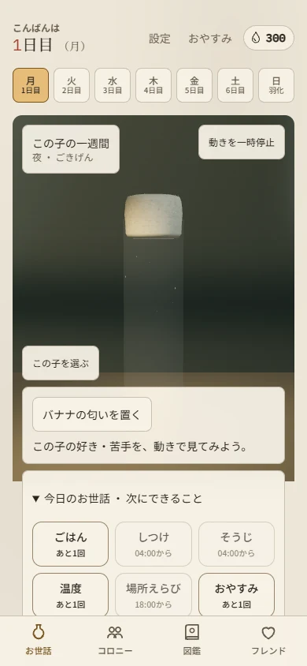
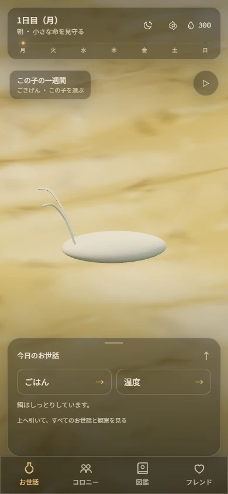
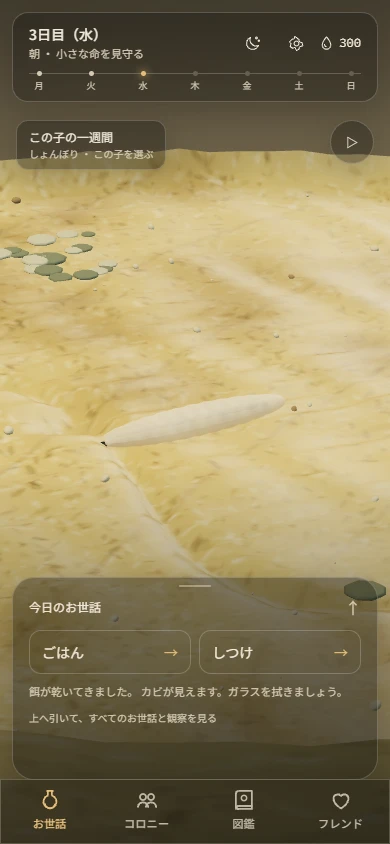
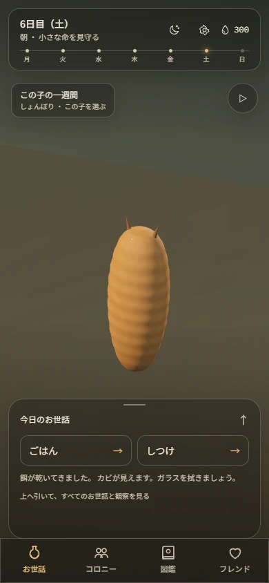
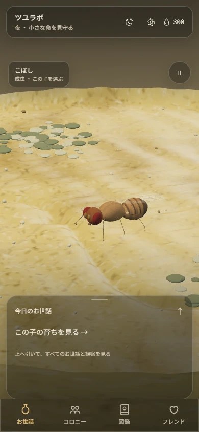
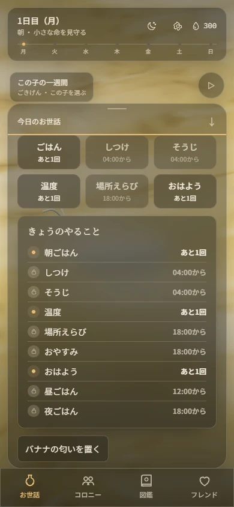
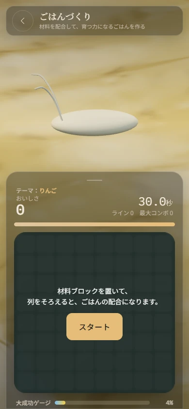
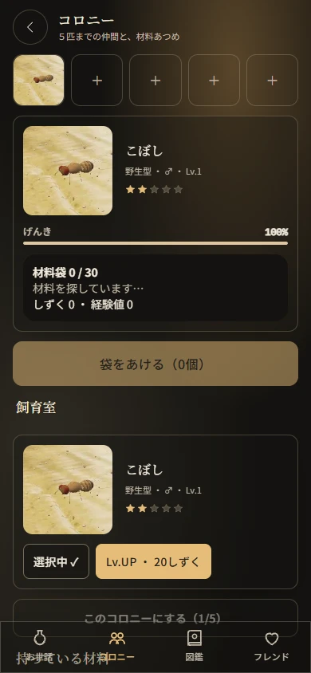
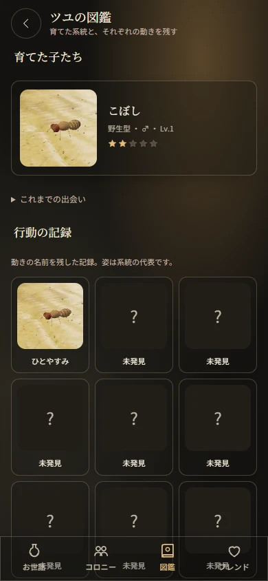

# W19 — the vial fills the screen

The home previously put the vial between beige cards, and the egg disappeared in its wide framing. W19 uses the rendered scene as the whole viewport, with a compact information bar and a care sheet floating over it.

Source: [vision-v2 §3](../../specs/vision-v2.md). No game rules, API contracts, authoritative individual data or dependencies changed.

## Before / after

Both captures use a 390 × 844 browser viewport. Before is the production site on 2026-10-13; after is the local production build with a fresh real-API guest. Time of day, seed and environment differ. These are browser renders, not physical iPhone screenshots.

| Production before | W19 after |
| --- | --- |
|  |  |

## What changed

- The scene reaches every viewport edge, including behind the top and bottom navigation. Ink, unbleached text and amber are the default even under a light system preference.
- The top bar holds day/time, sleep/settings icons and droplets. A thin seven-dot line labels the current day with amber and `aria-current`.
- Home care rests at 24dvh and shows at most two available actions. It follows dragging and expands to 72dvh; click, ArrowUp, ArrowDown and Escape work too. Full care, odour observation, diary and colony extras mount inside the expanded sheet.
- Dark overlay fill is 35% opaque, with a light hairline and blur. Reduced transparency receives a solid fallback. Calm fade/slide and spring-like settling stop under reduced motion; the entrance finishes without retaining a transform.
- Eggs and larvae frame the medium surface; pupae frame their glass site. Adults use a wider habitat composition. World-space autofocus remains on the organism, and tapping it is independent of camera orbit/zoom.
- Puzzles sit in a fixed sheet with internal scrolling, keeping the upper subject in view. Existing care surfaces replace the default scene through a portal. Care results, including meal and training success, stay inside the sheet; dragged blocks portal to the viewport so glass/blur containing blocks cannot offset the finger feedback.
- Game writes have a bounded 30-second transport deadline; auth and reads retain 12 seconds, including behind an API proxy prefix. Abort, idempotency and retries remain intact. Care transfers hold the current frame, then resume rendering. The still pupa and final eclosion evaluation use demand rendering; the emergence animates normally. Gameplay clocks, scoring, rewards and brain output remain authoritative on the API.
- Colony, collection and friends use individual renderer portraits with stable ID, sex and phenotypes. Visible portraits generate serially and share a bounded 64-image cache. Loading previews and hidden Canvas fallback markup cannot become a cached individual portrait. Unsupported WebGL retains a labelled common static image.
- Collection separates actual raised individuals from labelled strain/behavior representatives. Friend thumbnails fetch actual visible shelves before choosing an individual.

## Phone gallery

The seven API growth stages are captured, plus the expanded care list, a puzzle sheet, sleep care, colony and collection. All after images are actual WebGL frames from real API state at 390 × 844, Chromium / Windows SwiftShader, automatic low quality, with reduced motion. The egg-through-pupa frames are paused for inspection; the adult frame is captured live.

| Egg | Larva | Pupa | Adult |
| --- | --- | --- | --- |
|  |  |  |  |

Additional stages: [first instar](w19/home-larva1.webp), [third instar](w19/home-larva3.webp), [wandering larva](w19/home-wandering.webp).

| Full care list | Puzzle sheet | Colony | Collection |
| --- | --- | --- | --- |
|  |  |  |  |

Additional care capture: [sleep with the raised adult retained in view](w19/care-sleep.webp).

## Verification

- Web lint, explicit typecheck and production build passed.
- Vitest: 309 tests / 43 files passed. E2E helpers: 25 tests / 3 files passed.
- Phone capture / immersive regression and guest-start smoke passed in the capture run (3.6 minutes and 29.6 seconds).
- Final focused validation after the circuit-input and result-sheet fixes: fallback accessibility and the complete week both passed (2 tests, 14.8 minutes total; week 13.8 minutes). The week retained real timed meals, both circuit sizes, wiping, humidity, pupation, eclosion and persisted adult checks.
- All 12 phone captures decoded at 390 × 844 and were visually reviewed. `git diff --check` passed.

The four browser scenarios have successful results across the capture and focused validation runs. Earlier software runs exceeded their total time budgets; a later circuit run exposed the development clock's overlapping hit target. The final focused run passed with the same gameplay assertions and explicit confirmation that the first circuit cell accepts input.

The phone regression covers full-viewport bounds, dark default under a light preference, two-action resting care, keyboard/drag expansion, reduced motion, puzzle scrolling that preserves the visible subject, cold individual portrait generation. A separate cold-load diagnostic confirmed the portrait canvas is released after its snapshot. The week run uses the real API, timed meals, training, glass wiping, humidity/temperature, pupation selection, eclosion and the retained adult. Drag feedback is checked in viewport coordinates. The fallback test disables WebGL and verifies keyboard wiping and colony selection/swiping.

Software WebGL gets 60-second UI settling deadlines a four-minute fallback budget and a 20-minute week budget. Video recording is disabled in that environment to leave CPU time for rendering; screenshots and failure traces remain enabled. Ordinary hardware deadlines and the 15-minute week budget are unchanged. The development-only clock panel has pointer events disabled during circuit gestures and restored for clock actions, preventing it from intercepting a production puzzle cell. No API responses are substituted and server/game clocks are not fabricated by the test runner: progression uses the existing development clock UI.

Physical Android/iOS performance, Safari, touch ergonomics and the 60 fps target remain unverified. The software-renderer run is functional/browser evidence. Rendering realism still needs owner review.

## Reproduce

Use the repository's installed tools and a local SQLite database. In the API terminal, from the repository root:

```powershell
$env:UV_CACHE_DIR = "$PWD/.uv/cache"
$env:DATABASE_URL = "sqlite+aiosqlite:///./.codex-runs/game.db"
$env:TSUYU_DEV_TOOLS = "true"
$env:RATE_LIMITS_ENABLED = "false"
$env:CORS_ORIGINS = '["http://127.0.0.1:3119"]'
$env:OMP_NUM_THREADS = "1"
$env:MKL_NUM_THREADS = "1"
$env:OPENBLAS_NUM_THREADS = "1"
.\.tools\uv.exe run alembic -c services/api/alembic.ini upgrade head
.\.tools\uv.exe run python -c "import tsuyu_brain.api; import uvicorn; uvicorn.run('tsuyulabo_api.main:app', host='127.0.0.1', port=8119, log_level='warning')"
```

In the web terminal:

```powershell
$env:NEXT_PUBLIC_API_URL = "http://127.0.0.1:8119"
$env:NEXT_PUBLIC_DEV_TOOLS = "1"
npm.cmd run build -w apps/web
npm.cmd run start -w apps/web -- --hostname 127.0.0.1 --port 3119
```

In the test terminal:

```powershell
npm.cmd run lint -w apps/web
npm.cmd run typecheck -w apps/web
npm.cmd run test -w apps/web
npm.cmd run test:e2e:helpers -w apps/web
$env:NEXT_PUBLIC_API_URL = "http://127.0.0.1:8119"
$env:E2E_BASE_URL = "http://127.0.0.1:3119"
$env:PLAYWRIGHT_BROWSERS_PATH = "$PWD/.tools/browsers"
$env:E2E_SOFTWARE_WEBGL = "1"
$env:E2E_MEDIA_DIR = "$PWD/.codex-runs/week-media"
npm.cmd run test:e2e -w apps/web -- immersive.spec.ts week.spec.ts vial-accessibility.spec.ts smoke.spec.ts
```

`immersive.spec.ts` refreshes the W19 gallery; `W19_MEDIA_DIR` overrides its output. Keep the API and web running without rebuilding during the browser run. `npm.cmd ci` and `npx.cmd playwright install chromium` provision Node/browser dependencies if needed.

## Delivery

The sandbox records atomic steps in `.codex-runs/commits.jsonl`; the commander applies them with the Codex trailer. No SHA has been created here. Base HEAD: `3c3b85aa1e8379b7f0c238bd8ae62ab15333f036`, branch `feat/immersive-ui`. `docs/HANDOFF.md` is untouched.

The commit plan assigns each final file to one step. Existing files are not duplicated across entries. The commander applies this ordered sequence after review:

| Step | Planned subject | Purpose |
| --- | --- | --- |
| 1 | `feat(web): default to frosted ink and amber tokens` | Default ink, unbleached text and amber tokens |
| 2 | `feat(web): add calm overlay motion with reduced motion support` | Calm overlay motion with reduced-motion support |
| 3 | `feat(web): add translucent dark glass overlay material` | Shared translucent dark-glass material |
| 4 | `feat(web): add a compact floating home top bar` | Compact day/time and icon top bar |
| 5 | `feat(web): show the week as a thin seven day growth line` | Seven-dot growth progress line |
| 6 | `feat(web): add a draggable care sheet with keyboard controls` | Draggable, keyboard-operable care sheet |
| 7 | `feat(web): float navigation over the full viewport` | Full-viewport shell with floating navigation |
| 8 | `feat(web): frame each growth stage around the focused subject` | Focused framing for each growth stage |
| 9 | `feat(web): make the home vial full bleed with care in one sheet` | Full-bleed home and grouped care content |
| 10 | `feat(web): keep care puzzles over a single living vial` | One living scene behind internally scrolling care puzzles |
| 11 | `feat(web): cache individual portraits from the vivarium renderer` | Serial, bounded individual portrait snapshot cache |
| 12 | `feat(web): show owned adults as rendered portrait cards` | Portraits on owned adult cards |
| 13 | `feat(web): fill colony slots with individual portraits` | Portraits in colony slots |
| 14 | `feat(web): make the collection a gallery of raised individuals` | Raised-individual collection gallery |
| 15 | `feat(web): show actual individuals on friends shelves` | Actual visible individuals on friends shelves |
| 16 | `test(web): allow software gpu frames time to settle` | Software-GPU UI deadlines, retaining ordinary deadlines |
| 17 | `docs(web): preserve the production phone baseline for comparison` | Production phone baseline images |
| 18 | `fix(web): render eclosion only while the emergence is playing` | Demand rendering while eclosion is still |
| 19 | `test(web): verify immersive phone scenes and cold portrait loading` | Immersive phone and cold-gallery regression coverage |
| 20 | `fix(web): keep meal results and drag feedback usable in care sheets` | Inline meal results and viewport-positioned drag feedback |
| 21 | `fix(web): give game writes enough time to finish under render load` | Bounded game-write deadlines with auth/proxy regression tests |
| 22 | `docs(web): capture every growth stage and portrait gallery on phone` | Twelve phone captures across all growth stages, care and galleries |
| 23 | `test(web): follow the care sheet through week and accessibility flows` | Week and accessibility helpers for the care sheet |
| 24 | `feat(web): let the living vial stay visible during sleep care` | Dark sleep care with the actual adult retained behind the sheet |
| 25 | `fix(web): show training success inside the care sheet` | Training success inside the care sheet |
| 26 | `docs(web): report immersive phone changes and verification` | This before/after and verification report |

